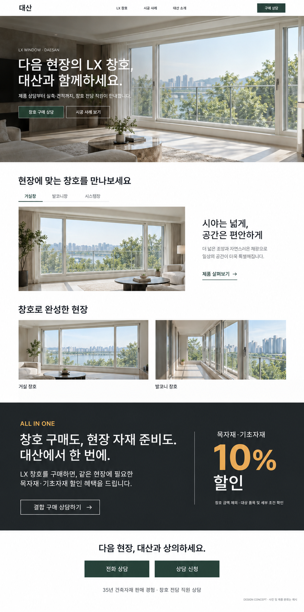

# 대산 LX 창호 랜딩 페이지 기획안

갱신: 2026-10-15 · 창호 중심 건축 화보형 목업을 기준으로 재작성
상태: 사용자 요청 구성 반영 완료. 세부 문구·제품·사진·운영 조건은 검토안이며 구현·공개 완료가 아니다.
카테고리 배치 사용자 승인: 2026-10-26. 아래 9절 참고. 기존 인트로·영상 시안의 결정은 이번 분류 작업에서 변경하지 않는다.
사업 기준: [MASTER_PLAN](MASTER_PLAN.md). [이전 구성안](../history/B2B_SITE_PLAN-before-window-first-2026-10-15.md)은 과거 기록이다.

## 1. 목적과 대상

인테리어·창호 시공 및 판매 업자에게 LX 창호와 대산의 상담 역량을 소개하고, 창호 구매 상담으로 연결한다. 일반 소비자도 내용을 이해하고 문의할 수 있는 공개 페이지다.

핵심 메시지는 ‘다음 현장의 LX 창호, 대산과 함께하세요.’이다. LX 창호의 제품과 적용 모습을 먼저 보여주고, ALL IN ONE 결합 구매 혜택을 대산을 선택할 추가 이유로 제시한다.

목자재·기초자재는 주로 벽 속 등 보이지 않는 부분에 쓰이는 자재다. 마감재 색상 조합이나 공간 연출 서비스로 설명하지 않는다. ALL IN ONE은 창호와 필요한 자재를 함께 구매하는 편의이며 인테리어 전체 시공을 의미하지 않는다.

목표 행동: 창호 구매 상담. 사업 성과: 실제 상담에서 실측 요청으로 연결되는 것.

## 2. 페이지 전체 흐름

**상단 메뉴 → 창호 메인 이미지 → 제품 탐색 → 시공 사례 → ALL IN ONE 구매 혜택 → 상담 신청 → 회사 정보**

| 순서 | 구간 | 방문자에게 전달할 내용 | 주요 행동 |
|---|---|---|---|
| 1 | 헤더 | 대산의 LX 창호 사이트 | 원하는 구간 이동 / 구매 상담 |
| 2 | 메인 | 다음 현장에 적용할 창호의 모습 | 창호 구매 상담 / 시공 사례 보기 |
| 3 | 제품 탐색 | 현장에 맞는 제품과 확인할 특징 | 제품 살펴보기 / 해당 제품 상담 |
| 4 | 시공 사례 | 실제 적용 모습과 현장 정보 | 사례 확인 / 해당 사례 상담 |
| 5 | ALL IN ONE | 창호 구매에 따른 자재 구매 편의와 10% 혜택 | 결합 구매 상담 |
| 6 | 상담 | 담당자에게 쉽게 문의하는 방법 | 전화 / 카카오톡 / 신청 접수 |
| 7 | 푸터 | 회사·연락처·운영 정보 | 회사 정보 및 개인정보 안내 확인 |

## 3. 구간별 화면과 문구

### 3.1 헤더

왼쪽 대산 로고, 가운데 ‘LX 창호 / 시공 사례 / 대산 소개’, 오른쪽 ‘구매 상담’ 버튼.
제품·사례 메뉴는 페이지 내 해당 구간으로 이동한다. ‘대산 소개’는 상담 구간의 35년 업력·회사 정보로 연결한다. 별도 회사 소개 페이지는 초기 필수 범위가 아니다. 구매 상담 버튼은 상담 신청 영역으로 이동한다.

화이트 배경과 얇은 구분선을 사용한다. PC는 얇은 고정 헤더를 제안하며 이동한 제목이 헤더에 가려지지 않도록 한다.

### 3.2 메인 — 창호가 주인공인 첫 화면

- 작은 문구: LX WINDOW · DAESAN
- 제목: **다음 현장의 LX 창호, 대산과 함께하세요.**
- 설명: 제품 상담부터 실측·견적까지, 창호 전담 직원이 안내합니다.
- 대표 버튼: **창호 구매 상담**
- 보조 버튼: **시공 사례 보기**

창호 프레임·유리·개방감이 잘 드러나는 큰 시공 사진 한 장을 사용한다. 사진 위에 짧은 문구와 버튼을 배치하고 텍스트 뒤에만 명암을 보완한다. 자동 슬라이드나 영상 없이 정적 대표 사진으로 시작한다.

첫 화면에는 목자재 사진, 자재 조합 도구, 할인 숫자를 넣지 않는다. 실제 LX 제품·사용 권한이 확인된 사진을 선정하며 생성 목업 사진을 실제 시공 실적으로 게시하지 않는다.

### 3.3 제품 탐색

제목: **현장에 맞는 창호를 만나보세요.**

PC는 왼쪽 큰 제품 사진, 오른쪽 특징과 제품 링크를 둔다. 상단 탭을 선택하면 해당 제품군의 사진과 설명이 함께 바뀐다. 목업의 ‘거실창 / 발코니창 / 시스템창’은 예시이며 실제 취급 제품과 겹치지 않는 분류로 확정한다.

제품마다 모델명, 적용 공간, 확인된 핵심 특징 2~3개, 제품 상세 보기, 해당 제품 상담을 제공한다. 첫 화면에서 모든 규격을 요구하지 않는다. ‘시야는 넓게, 공간은 편안하게’는 문구 예시이며 실제 제품에 맞춰 최종 작성한다.

제품 상세는 같은 사이트의 별도 상세 화면으로 제안한다. 모델·공식 이미지·특징·선택 사양·관련 사례·상담 순으로 구성한다. 영업직원과 블로그에서 개별 링크로 전달할 수 있게 한다. 취급 목록을 확인한 뒤 제작 수량을 정한다.

제품 상담 버튼은 선택한 모델을 상담 폼에 표시하고 사용자가 변경할 수 있게 한다. 단열·차음·보증 수치는 해당 모델과 조건에 대한 공식 근거를 확보한 경우에만 사용한다.

### 3.4 시공 사례

제목: **창호로 완성한 현장**

PC에서는 가로 사진 두 개를 나란히 배치한다. 모바일에서는 세로로 쌓는다. 대표 사례 2건으로 시작하되 실제 확보 자료에 맞춘다.

사례에는 현장 유형·공개 가능한 지역·적용 제품·공사 범위를 짧게 표시한다. 상세에서는 전체 창호 사진 → 디테일 → 현장 요구와 제품 선택 이유 → 대산 및 협력업체 역할 → ‘이 사례로 상담하기’를 제공한다.

사진은 실적과 사용 권한이 확인된 자료를 사용한다. LX 공식 사진은 공식 제품 예시로 구분하며 대산 실적으로 표현하지 않는다. 생성 목업 이미지와 임의 후기는 공개 실적에 사용하지 않는다.

### 3.5 ALL IN ONE — 시공 사례 다음, 상담 신청 바로 앞

이 구간은 독립된 가로 섹션으로 구성한다. 차콜 배경, 흰 글씨, 차분한 골드색 숫자를 사용한다. 목자재 사진 없이 문구로 전달한다.

**왼쪽**

ALL IN ONE

**창호 구매도, 현장 자재 준비도. 대산에서 한 번에.**

LX 창호를 구매하면, 같은 현장에 필요한 목자재·기초자재 할인 혜택을 드립니다.

버튼: **결합 구매 상담하기 →**

**오른쪽**

목자재·기초자재

**10% 할인**

창호 금액 제외 · 대상 품목 및 세부 조건 확인

‘목자재·기초자재’와 ‘10%’를 같은 시각 묶음으로 배치한다. 창호 할인으로 오해하지 않게 제외 조건을 바로 아래 읽을 수 있는 크기로 표시한다. 같은 현장 조건을 본문에 유지한다.

버튼을 누르면 동일한 상담 폼으로 이동하고 관심 내용을 ‘창호 + 목자재·기초자재 결합 구매’로 표시한다. 할인 계산기·장바구니·온라인 주문 기능은 만들지 않는다.

할인율과 같은 현장·창호 제외 원칙은 사용자 확인 사항이다. 구체적인 대상 품목, 기준 가격, 적용 시점, 제외 조건은 미확정이다. 내부 목업에서는 위 문구로 검토하고 공개 전 상세 조건을 확정한다. 모든 판매 품목에 무조건 적용되는 혜택으로 확대하지 않는다.

### 3.6 상담과 신뢰

제목: **다음 현장, 대산과 상의하세요.**

대표 버튼 ‘전화 상담’, ‘상담 신청’을 배치하고 ‘카카오톡 상담’ 링크도 제공한다. 하단에는 ‘35년 건축자재 판매 경험 · 창호 전담 직원 상담’을 표시한다. 35년은 창호 제조·시공 경력이 아니다.

짧은 절차 안내: 전담 직원 상담 → 고객 실측 요청 및 일정 협의 → 협력업체 실측 → 견적서 안내 → 주문.

상담 신청은 실측 예약 확정이나 주문을 의미하지 않는다. 상담 구간 안에 간단한 펼침 안내로 실측 절차와 할인 적용 조건을 확인할 수 있게 한다. 별도의 긴 절차 섹션을 추가해 목업의 흐름을 늘리지 않는다.

### 3.7 푸터

실제 회사명, 주소, 사업자 정보, 전화번호, 응대 시간, 카카오톡 링크, 개인정보 처리방침을 확인 후 표시한다. 회사 소개는 35년 건축자재 판매 경험과 전담 상담 체계 중심으로 간결하게 작성한다.

## 4. 상담 신청 동작

| 입력 항목 | 기준 |
|---|---|
| 연락처 | 필수 |
| 개인정보 수집·이용 동의 | 수집 목적·항목·보관 기준 확정 후 필수 |
| 이름/업체명 | 선택 |
| 현장 지역 | 선택 |
| 관심 내용 | 선택: 창호 구매 / 결합 구매 / 기타 |
| 문의 내용 | 선택 |

회원가입, 상세 치수, 도면, 제품 코드는 첫 접수에서 요구하지 않는다. 제품·사례·혜택 버튼의 출발 정보를 폼에 표시하고 수정 가능하게 한다. 전화와 카카오톡은 폼 없이 바로 연결한다.

신청 성공은 실제 접수 저장을 확인한 뒤 표시한다. 안내 문구는 ‘상담 신청이 접수되었습니다. 창호 전담 직원이 남겨주신 연락처로 연락드립니다.’로 한다. 실패 시 입력을 보존하고 재시도와 전화/카카오톡 경로를 제공한다. 중복 접수를 방지한다.

응대 시간과 회신 기준은 실제 운영 확인 후 표시한다. 즉시 회신, 무료 실측, 전국 시공 등 미확인 서비스는 약속하지 않는다.

## 5. UI·모바일 기준

- 전체 인상: 건축 화보형. 큰 창호 사진, 넓은 여백, 정돈된 글자와 얇은 구분선.
- 색상 제안: 화이트 #FFFFFF, 본문 차콜 #222828, 상담 버튼 딥그린 #23433A, 혜택 배경 #232829, 할인 강조 골드 #E8B45F. 실제 제작 시 가독성을 확인한다.
- 글꼴: 읽기 쉬운 한글 고딕 계열. 제목은 굵게, 본문은 간결하게. 본문은 모바일 16px 이상을 기본 제안으로 삼는다.
- PC: 넓은 사진과 2열 제품·사례 구성. 과도한 둥근 카드·그림자·장식은 줄인다.
- 모바일: 창호가 잘 보이는 사진 크롭을 별도로 정하고 제목·버튼을 겹치지 않게 배치한다. 제품 사진과 설명, 사례, 혜택을 1열로 쌓는다.
- 모바일 ALL IN ONE: 설명 → 목자재·기초자재 10% → 조건 → 상담 버튼 순서. 조건 문구를 접거나 생략하지 않는다.
- 모바일 하단: 전화 상담 / 상담 신청 고정, 카카오톡은 상담 구간에 제공한다. 고정 바가 콘텐츠·폼·키보드와 충돌하지 않게 한다.
- 움직임은 짧은 전환 정도로 제한한다. 자동 재생·강제 스크롤 없이 키보드와 터치로 모든 탭·버튼을 사용할 수 있게 한다.

### 5.1 다이나믹 요소 (1차 적용 4개)

| 구간 | 동작 | 기준 |
|---|---|---|
| 메인 | 첫 진입 시 대표 사진이 1~2초 동안 살짝 확대되며 등장하고, 작은 문구 → 제목 → 버튼 순으로 떠오른다 | 한 번만 재생. 사진은 정적 대표 사진 1장 유지(슬라이드·영상 아님). 버튼은 등장 전에도 누를 수 있게 한다 |
| 헤더 | 스크롤을 내리면 높이가 줄고 흰 배경·구분선이 생긴다. 현재 보고 있는 구간의 메뉴에 밑줄을 표시한다 | 메뉴 이동 시 제목이 헤더에 가려지지 않게 한다 |
| 제품 탐색 | 탭을 바꾸면 사진은 서서히 교체(크로스페이드), 설명은 아래에서 위로 짧게 등장한다. 선택 탭의 밑줄이 옆으로 미끄러진다 | 전환 중 연속 클릭에도 화면이 꼬이지 않게 한다. 키보드 좌우 화살표로 탭 이동 |
| ALL IN ONE | 구간이 화면에 들어오면 ‘10%’ 숫자가 0에서 10으로 한 번 올라간다 | 조건 문구(창호 금액 제외 등)는 애니메이션 없이 처음부터 표시한다. 최종 숫자는 화면 낭독기에 바로 읽히게 한다 |

공통 기준:
- 각 동작은 0.2~0.6초(메인 등장만 최대 2초) 안에 끝내고, 같은 요소는 한 번만 움직인다.
- 기기의 ‘동작 줄이기’(prefers-reduced-motion) 설정 시 움직임 없이 최종 상태로 표시한다.
- 모바일도 같은 4개를 적용하되, 저사양 기기에서 스크롤 끊김이 없는지 확인한다.
- 제외: 자동 슬라이드, 배경 영상, 패럴랙스·강제 스크롤, 커서 추적, 과한 3D 효과.
- 특징 핫스팟, 전·후 비교 슬라이더, 사례 호버, 절차 진행 표시는 실제 자료 확보 후 2차 검토한다.

## 6. 준비할 자료

| 자료 | 사용 위치 | 확인할 내용 |
|---|---|---|
| 창호 대표 사진 | 메인 | 실제 제품, 사용 권한, PC/모바일 크롭 |
| 실제 취급 제품 목록·공식 카탈로그 | 제품 탐색·상세 | 모델, 분류, 특징, 사양 |
| 대표 시공 사례 사진과 현장 정보 | 사례 | 대산 역할, 게시 동의, 실제 제품 |
| 할인 세부 조건 | ALL IN ONE | 대상 품목, 기준 가격, 시점, 제외 조건 |
| 로고·회사 정보·업력 자료 | 헤더·상담·푸터 | 표기 및 증빙 |
| 전화·카카오톡·운영 시간 | 상담 | 실제 연결처와 담당자 |
| 접수 운영·개인정보 안내 | 상담 폼 | 접수 저장처, 담당자 확인, 보관 기준 |

보유 자료가 있다는 사용자 확인과 웹 게시용 파일 검수 완료는 구분한다. 할인 상세 답변을 현재 기획의 선행 조건으로 강제하지 않고 공개 준비 단계에서 확인한다.

## 7. 성과와 제작 범위

핵심 지표: 실측 요청 건수, 같은 상담 집단의 상담→실측 요청 전환율. 실제 상담·견적·주문을 보조 지표로 관리한다. 목표 수치는 초기 데이터 확보 후 정한다.

웹에서는 제품/사례 탐색, 혜택 상담 버튼, 전화·카카오톡 클릭, 신청 성공을 구분해 기록한다. 클릭을 실제 상담이나 실측 요청으로 계산하지 않는다. 직원이 동일 고객·현장의 상담과 실측 요청·실측 완료·견적·주문을 구분해 기록한다. 분석 이벤트와 URL에는 연락처 등 개인정보를 넣지 않는다.

이번 기획 범위: 랜딩 한 페이지, 제품·사례 상세 연결, 최소 상담 폼과 세 상담 채널. 회원가입·결제·복잡한 온라인 견적·AI 챗봇·음성은 포함하지 않는다. 2차 B2C 개발은 중단 상태를 유지한다.

다음 작업: 실제 자료 선별 → 제품 분류·문구 확정 → PC/모바일 상세 화면 → 구현 → 상담 접수·링크·모바일 검증 → 공개 조건 확인.

## 8. 기준 목업

내장 이미지 생성 도구로 만든 정적 시안이다. 이미지·제품 분류·일부 설명은 예시이며 실제 제품이나 시공 증빙이 아니다. 목업은 배치와 시각 방향의 기준으로 사용하고, 상담 채널과 동작은 본 기획안을 따른다.

## 9. 카테고리와 배치 정리 — 2026-10-26 승인 구성

이번 요청은 콘텐츠 분류와 메뉴/본문 배치 정리다. 시각 디자인·코드 구현은 포함하지 않는다. 기존 창호 중심 방향을 유지하며 다음 구성을 사용자가 승인했다. 구간별 원고와 자료 목록은 [홈페이지 문구 문서](B2B_HOMEPAGE_COPY.md)에서 관리한다.

### 상단 메뉴

대산 로고(홈) | LX 창호 | 시공 사례 | 대산 소개 | [창호 상담 신청]

- LX 창호: 본문 제품 구간으로 이동. 제품별 상세는 별도 링크로 제공.
- 시공 사례: 본문 사례 구간으로 이동. 현장별 상세는 별도 링크로 제공.
- 대산 소개: 본문 상담 영역 안의 35년 업력·전담 직원·회사 소개로 이동.
- 창호 상담 신청: 전화·카카오톡·연락처 신청을 제공하는 상담 영역으로 이동하는 주요 버튼. 온라인 견적 계산이나 주문 확정 의미가 아니다.

### 홈페이지 본문 순서

| 순서 | 카테고리 | 내용 |
|---|---|---|
| 1 | 창호 메인 | LX 완성창 취급과 현장 구매 상담 제안. 기존 인트로 작업은 별도 기준 유지 |
| 2 | LX 제품소개 | 실제 취급 모델, 적용 공간, 검증된 특징, 제품 상세 링크 |
| 3 | 시공 사례 | 실제 대표 사례 2건부터 시작. 현장 조건·제품·공사 범위·대산 역할 |
| 3-1 | 고객후기 | 사례에 연결해 보조 배치. 게시 동의·원문 확인된 자료가 있을 때만 공개; 없으면 해당 부분 생략 |
| 4 | ALL IN ONE 구매 혜택 | 같은 공사 목자재·기초자재 10% 할인. 창호 금액 제외, 세부 조건 추후 확인. 사례 다음·상담 영역 앞 유지 |
| 5 | 대산 소개·상담 안내·신청 | 아래 내용을 하나의 상담 영역 안에서 간결하게 구성 |
| 6 | 회사 정보 | 회사명·주소·연락처·운영시간·사업자 정보·개인정보 안내 |

상담 영역 내부 순서:
1. 35년 건축자재 판매 경험과 창호 전담 직원 소개. 창호 제조·시공 경력으로 표현하지 않는다.
2. 상담에서 안내받을 내용: 제품 자료·관련 사례·실측 준비 정보(실제 제공 가능 자료 확인 필요).
3. 진행 절차: 상담→실측 요청·일정 협의→협력업체 실측→견적→주문.
4. FAQ: 도면/치수 없이 상담 가능한지, 실측 요청 방법, 견적 제공 과정, 자재 혜택 조건, 시공·A/S 문의 창구. 미확정 운영 조건은 사실 확인 후 답변한다.
5. 전화·카카오톡·연락처 남기는 신청. FAQ를 읽어야만 신청할 수 있는 필수 단계로 만들지 않는다.

### 초기 독립 메뉴로 두지 않는 항목

- ALL IN ONE: 제품·사례를 본 뒤 구매 이점을 이해하도록 본문에 배치.
- 고객후기: 초기 자료 규모를 고려해 사례 안에서 제공. 자료 축적 뒤 독립 메뉴 검토.
- FAQ·진행 절차: 상담 영역 안의 안내이며 별도 장문 페이지 불필요.
- 창호 지식·블로그·영상: 자료 및 운영 계획 확보 후 추가. 기존 영업 링크·네이버 블로그 유입 전략은 유지하며 자체 블로그 구축을 필수화하지 않는다.
- 전시장: 실제 방문 가능한 전시 공간·운영 정보가 확인될 때 회사 정보에서 안내.
- 실시간 상담 현황·예약 달력·금융 혜택: 초기 필수 카테고리로 채택하지 않는다.
- AI 채팅: 독립 2차 범위, 중단 유지.

다음: 실제 제품·사례·회사 자료를 원고에 연결하고 FAQ의 실제 응대 내용을 확정한다. 사용자 지시로 현재 작업은 문구·자료 정리까지만이며 사이트 제작은 진행하지 않는다.
